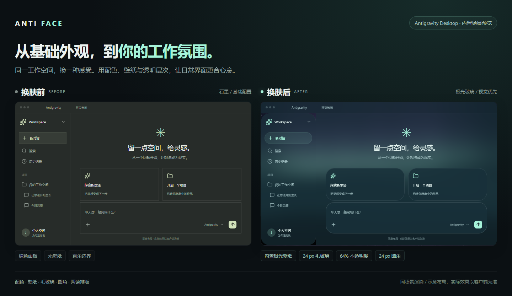
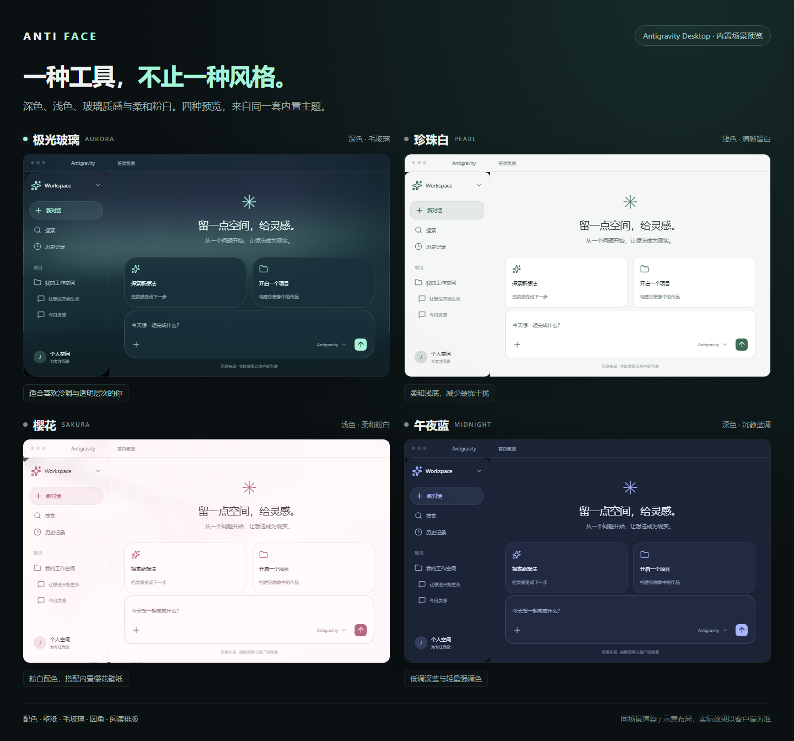
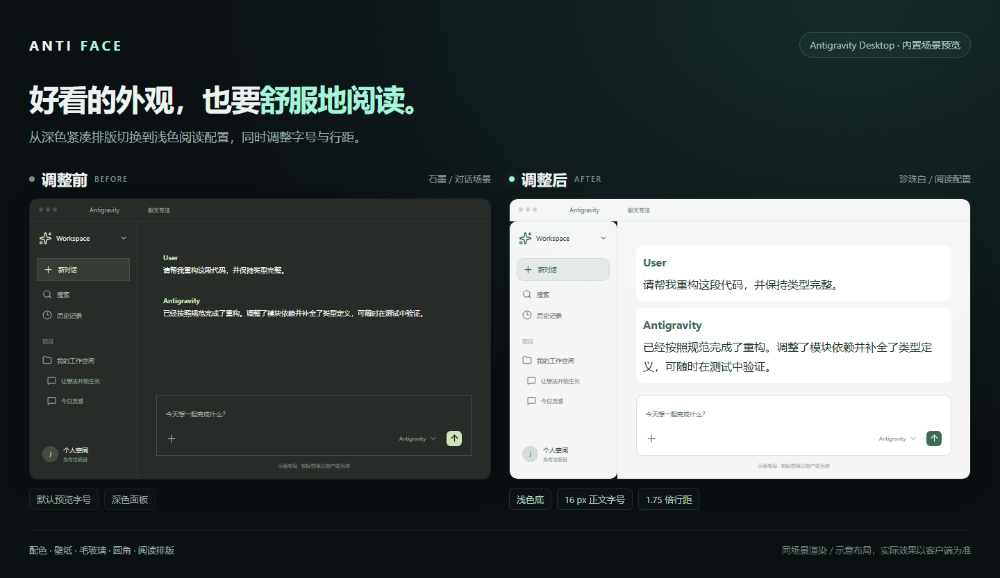
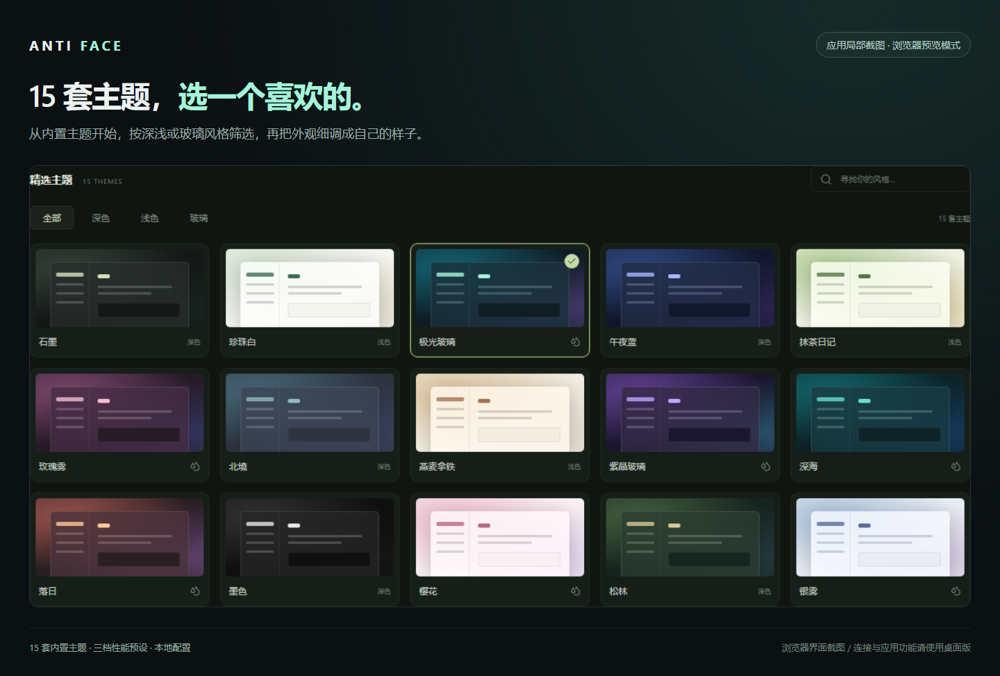

<div align="center">

# Anti Face

### 让 Antigravity 的工作空间，有你的风格。

为 Windows 上的 Antigravity Desktop 定制配色、壁纸、毛玻璃与阅读排版。

A local theme studio for Antigravity Desktop on Windows.

<a href="https://github.com/Will-McAvoy/anti-face/releases"></a>
<a href="https://github.com/Will-McAvoy/anti-face/releases/latest"></a>
<a href="https://github.com/Will-McAvoy/anti-face/actions/workflows/ci.yml"></a>
<a href="LICENSE"></a>

**[下载 Windows 便携版](https://github.com/Will-McAvoy/anti-face/releases/download/v0.6.3/Anti.Face.0.6.3.exe)** · [查看版本说明](https://github.com/Will-McAvoy/anti-face/releases/tag/v0.6.3) · [快速上手](#几步开始使用)

免安装运行 · 15 套内置主题 · 20 套精选壁纸 · 可恢复外观

</div>

## 换肤前后，一眼看见变化



左侧是无壁纸的「石墨」基础配置，右侧是「极光玻璃」搭配内置壁纸与视觉优先预设。相同的内容与布局，让配色、透明层次和圆角的变化更直观。

> 对比与主题画廊由软件内置预览组件渲染；工作室图片为运行界面截图。预览使用示意布局，实际效果以客户端为准。[查看图片来源与生成方式](docs/SHOWCASE.md)。

## 选一种适合你的工作氛围



| 你想要的感觉 | 可以从这里开始 |
| --- | --- |
| 沉静专注 | 石墨、午夜蓝、墨色：深色底与低饱和层次 |
| 明亮清爽 | 珍珠白、抹茶日记、燕麦拿铁：柔和浅底与清晰留白 |
| 更有氛围 | 极光玻璃、樱花、银雾：搭配壁纸、透明度和毛玻璃 |

主题可以继续细调：全局、侧边栏、聊天区、输入框和卡片分别设置；喜欢的搭配可另存、收藏、打标签，或导出分享。

## 外观好看，阅读也舒服



按自己的习惯调整正文字号、行距和内容宽度。壁纸支持位置、缩放、遮罩与模糊调整；也可以从本地文件夹轮换壁纸。

## 在工作室里，先预览再应用



**选择主题 → 调整外观 → 查看预览 → 选择目标窗口 → 确认应用。**

想轻一点，选「性能优先」；想多一点质感，选「视觉优先」。需要撤回时，可以恢复所选窗口的外观；实时试穿默认关闭，开启后取消会恢复试穿前的样式。

## 几步开始使用

适用于 **Windows 10 / 11 x64**。便携版无需安装 Node.js。

1. 下载 [Anti.Face.0.6.3.exe](https://github.com/Will-McAvoy/anti-face/releases/download/v0.6.3/Anti.Face.0.6.3.exe)，双击运行。
2. 在「主题与外观」选择主题，调整壁纸和参数，在预览区查看效果。
3. 启动 Antigravity Desktop，在「连接与兼容」检测并选择目标窗口。
4. 查看变化摘要，确认后应用；需要还原时使用恢复功能。

应用前会检查宿主版本与文件指纹；若提示不兼容或连接异常，请先按页面诊断处理。兼容记录与数据能力说明见 [项目状态](docs/STATUS.md) 和 [兼容性与遥测说明](docs/TELEMETRY-CAPABILITIES.md)。

便携版尚未配置代码签名，Windows 首次运行可能显示未知发布者；请从本仓库 Releases 下载，并按下方说明核对 SHA256。

## 不止换肤

| 功能 | 你可以做什么 |
| --- | --- |
| 主题库 | 保存、收藏、筛选、导入导出主题，复制局部设置，撤销与重做编辑 |
| 阅读与壁纸 | 调整排版、区域样式、遮罩与壁纸轮换，管理 20 套离线精选 |
| 多窗口与恢复 | 选择应用窗口、恢复外观、按需开启刷新后恢复与自动备份 |
| 任务与 Token 观测 | 查看宿主提供的任务状态、用量、输出延迟与区间速率 |
| 本地历史 | 按需启用记录，按日期、模型与项目筛选，导出 CSV / JSON |

观测数据取决于宿主提供的能力，界面会标明可用性与新鲜度。Token 速率基于有效区间计算；外观设置不会改变模型推理速度。历史记录、自动切换、托盘、全局快捷键、迷你窗与提示音均可按需启用。

## 从源码运行

需要 Windows 10 / 11 x64、Node.js 22.12+（推荐 Node.js 24）。

```powershell
npm ci
npm run build
npm start
```

| 命令 | 用途 |
| --- | --- |
| `npx vite preview --host 127.0.0.1` | 在浏览器中预览构建后的工作室界面 |
| `npm run build` | TypeScript 检查与前端构建 |
| `npm start` | 启动构建后的桌面应用 |
| `npm run check` | 构建与自动化测试 |
| `npm run test:desktop` | 桌面界面冒烟检查 |
| `npm run verify:host` | 在宿主上验证应用与恢复链路 |
| `npm run package` | 构建 Windows x64 便携版 |
| `node scripts/capture-readme.mjs` | 重新生成本页预览图与界面截图 |

截图和渲染测试需要 Chromium：`npx playwright install chromium`。浏览器预览用于调整外观，连接客户端请使用桌面版。

开发文档：[系统架构](docs/ARCHITECTURE.md) · [版本与验证记录](docs/STATUS.md) · [v0.6.3 发布报告](docs/V0.6.3-RELEASE-REPORT.md) · [展示图说明](docs/SHOWCASE.md)

## 下载校验

v0.6.3 发布附件：`Anti.Face.0.6.3.exe`，178,680,691 字节。

```text
SHA256  0e38fe84b3328252b2edac8c4f39c9652f2d40f52c72b17946bb0a8698777b38
```

PowerShell 校验：`Get-FileHash .\Anti.Face.0.6.3.exe -Algorithm SHA256`。自行构建的文件哈希会不同；构建产物和本地测试日志不入库。

## 许可证

[MIT License](LICENSE) · Copyright (c) 2026 Will-McAvoy
