# Anti Face 第六轮实施计划：七项实用功能 (v0.5.0)

**制定日期**：2026-10-08（Asia/Taipei）  
**基线版本**：0.4.3（151 项测试全绿，历史 EXE 产物完整保留）  
**目标版本**：0.5.0  
**工程约束**：源码目录无 Git 元数据；开工前已将基线完整归档至 `.backups/round6-baseline-2026-10-08/`。

---

## 1. 总体架构与状态分层

遵循 Round 6 严格状态分层与操作令牌约束：

```mermaid
flowchart TD
    subgraph Layer1["1. 用户编辑草稿与撤销栈 (内存/会话)"]
        Draft[documentRef / AppearanceHistory]
        Baseline[Session Baseline 初始快照]
    end

    subgraph Layer2["2. 持久化存储 (磁盘 userData)"]
        AppDoc[appearance.json]
        Library[theme-library.json + assets/]
        Prefs[preferences.json]
        Bindings[project-bindings.json]
        Revisions[theme-revisions/]
        SafetyMarker[runtime-session.json]
    end

    subgraph Layer3["3. 目标窗口应用状态 (内存管理)"]
        TargetState[Round5 TargetState: instanceId / generation / manualHold]
        AppliedCSS[activeDocument / lastVerifiedDocument]
    end

    subgraph Layer4["4. 运行时临时覆盖与屏障 (不落盘)"]
        RecoveryBarrier[Recovery Barrier 恢复屏障]
        PerfOverride[Performance Tier 覆盖: normal / lightweight / powersave]
        SafeModeState[Safe Mode 标志与自动抑制]
    end

    subgraph Layer5["5. 系统与外部观测 (事件与传感器)"]
        DisplayObs[DisplayContext: DIP / Scale / Viewport]
        PowerObs[Power State: AC / Battery / Unknown]
        TelemetryObs[Telemetry / TaskNotificationEvent]
    end

    Draft -->|Commit with Token| AppDoc
    PerfOverride -->|Resolver Layer| AppliedCSS
    RecoveryBarrier -.->|Invalidate| TargetState
    DisplayObs -->|Recalculate Viewport| AppliedCSS
```

---

## 2. 七项功能已有能力、新增部分与受影响文件

### F01：一键恢复与安全启动 (Recovery & Safe Launch)

- **已有能力**：
  - `ThemeService.restore(targetId)` 与 `StudioService.restoreAll()` 已存在基础恢复逻辑。
  - `intentGate` / `beginIntent` 已有 generation 操作令牌机制。
- **需要新增/完善**：
  - **恢复屏障 (Recovery Barrier)**：在恢复开始前置位全局恢复屏障，同步令所有旧自动化、场景观测、性能降级和在途试穿全部作废（generation 递增 + activeDocument 清空）。
  - **逐目标结构化结果**：支持单目标及全目标并发受限恢复，按目标清晰返回 `{ [targetId]: { state: 'ready' | 'detached' | 'failed' | 'unconfirmed', message } }`，杜绝部分失败报“全部成功”。
  - **安全启动机制 (Safe Launch)**：
    - `desktop/safe-launch.cjs`：在 userData 维护 `runtime-session.json`（原子写入 sessionId, status: 'starting'|'running'|'stopping'|'clean', failureCount）。
    - 正常退出写入 `clean`；非正常退出下次启动判定为 unclean。
    - 连续 >= 2 次启动失败默认安全模式，单次异常进入异常询问弹窗/提示。
    - CLI 启动参数 `--safe-mode` 支持与透传。
    - 安全模式行为：无自动注入、自动换肤与场景关闭、通知与音效全抑制；保留编辑、诊断、备份与恢复入口。
    - 退出安全模式由用户显式触发，不自动补发历史任务。
  - **托盘与主界面入口**：“恢复所有窗口原貌”动作，主界面醒目恢复按钮与状态展示。
- **受影响文件**：
  - `desktop/safe-launch.cjs` (新增)
  - `desktop/studio-service.cjs`
  - `desktop/main.cjs`
  - `src/App.tsx`
  - `desktop/preload.cjs`、`core/ipc-policy.cjs`

---

### F02：编辑撤销/重做完善与基线 (Undo/Redo & Baseline)

- **已有能力**：
  - `core/appearance-history.cjs`：实现了 `push`, `beginGesture`, `endGesture`, `cancelGesture`, `undo`, `redo`。
  - `src/App.tsx`：具有撤销/重做快捷键与局部调用。
- **需要新增/完善**：
  - **覆盖全部编辑入口**：
    - 颜色、透明度、模糊、圆角、排版、区域定制。
    - 壁纸操作：新增、替换、移除、十字准星焦点拖动、缩放、遮罩强度与构图策略。
    - 阅读建议采用 (adoptReadability)、配色方案整体与按角色采用 (adoptColors)。
    - 版本历史局部或全部草稿载入。
    - 主题整体重置与“恢复进入编辑时状态 (revert to baseline)”。
  - **动作名称与原生输入保护**：
    - 每步历史记录带清晰简短标签（如“修改侧栏透明度”、“调整壁纸焦点”）。
    - 侦测 `input`、`textarea`、`contenteditable` 及 IME 组合期间，快捷键严格让渡给原生撤销，不抢占。
  - **滑块与手势合并**：
    - 滑块连续拖动、十字焦点拖拽：确保单次 drag 只产生一个 undo 步骤。
    - pointercancel、失焦、弹窗、切换目标等正确关闭/取消 gesture。
  - **会话基线与资产保活**：
    - 进入编辑会话保存 baseline 快照，提供“恢复进入时状态”可撤销动作。
    - 切换主题时清理或独立隔离栈，不串染新主题。
    - 历史中引用的 assetId 建立会话级引用保持，避免壁纸移除后被垃圾回收导致 undo 变空白。
- **受影响文件**：
  - `core/appearance-history.cjs`
  - `src/App.tsx`
  - `src/components/AppearancePanel.tsx`
  - `src/components/Round5Page.tsx`
  - `desktop/asset-store.cjs`

---

### F03：主题快速切换器 (Quick Theme Switcher)

- **已有能力**：
  - `StudioService.applyLibraryTheme` 具备主题应用逻辑。
  - `ShortcutService` 具备全局快捷键注册与冲突检测能力。
- **需要新增/完善**：
  - **快速切换窗口控制器 (`desktop/quick-switcher.cjs`)**：
    - 独立轻量 `BrowserWindow`（无边框、浮窗样式、居中于当前工作区）。
    - 专用预加载脚本 `desktop/switcher-preload.cjs`，严格限制 IPC 权限（只允许 `switcher:init`, `switcher:apply`, `switcher:close`，无文件或系统敏感操作）。
    - 独立前端入口 `desktop/switcher.html` 或嵌入轻量页面，支持脱机与生产打包。
  - **切换器功能与交互**：
    - 显示当前可用目标窗口，支持切换目标。
    - 搜索框：支持主题名称、内置/自定义标识实时筛选，**纯本地过滤，绝不触发主题注入**。
    - 收藏列表、最近使用列表（仅在真正应用成功后记录）、全部主题列表。
    - 键盘上下选择、Enter 确认应用、Esc 退出；高亮不注入，仅 Enter 或点击应用。
    - 脏草稿与试穿中冲突处理：有未保存草稿时提示，不静默覆盖。
    - 快捷键默认关闭，支持用户自定义全局热键呼出。
- **受影响文件**：
  - `desktop/quick-switcher.cjs` (新增)
  - `desktop/switcher-preload.cjs` (新增)
  - `desktop/switcher.html` (新增)
  - `desktop/studio-service.cjs`
  - `desktop/main.cjs`
  - `core/ipc-policy.cjs`

---

### F04：多显示器与 DPI 适配 (Display Context & DPI)

- **已有能力**：
  - `MiniWindowController` 有基础的屏幕 bounds 越界修正。
- **需要新增/完善**：
  - **坐标体系与单位转换 (`core/display-context.cjs`)**：
    - DIP（桌面逻辑坐标）
    - 屏幕物理像素与 scaleFactor (DPR)
    - 宿主 DOM CSS 像素 (viewport / rect)
    - CDP 截图像素与 clip scale
    - 集中无损往返转换函数，支持多屏负坐标（主屏左侧/上方）。
  - **窗口恢复与防离屏 (`desktop/display-service.cjs`)**：
    - 主窗口、迷你窗、快速切换窗记忆 bounds 及 displayId。
    - 启动/恢复时与当前所有连接显示器的 workArea 求交，若屏幕移除或完全不可见，自适应回退到主屏安全区域，确保标题栏和控制区可见。
    - 监听 `screen` 的 `display-added`, `display-removed`, `display-metrics-changed` 并防抖。
  - **宿主 CDP 视口与 DPR 感知**：
    - 目标窗口维护 `viewportVersion` 与 `contextHash`。
    - 跨屏或 resize 导致视口变化时，防抖重算壁纸 cover/contain 构图与阅读保护，**使旧截图与旧性能采样失效**。
    - resize 不修改用户原始主题，不产生多余的 undo 或正式历史。
- **受影响文件**：
  - `core/display-context.cjs` (新增)
  - `desktop/display-service.cjs` (新增)
  - `desktop/main.cjs`
  - `desktop/round5-service.cjs`

---

### F05：完整备份与迁移 (Complete Backup & Migration)

- **已有能力**：
  - `SettingsStore` 与 `ThemeLibrary` 单一主题导入导出。
- **需要新增/完善**：
  - **备份服务 (`desktop/backup-service.cjs`)**：
    - 格式：受控 PKZip / `.antiface-backup` 归档格式（使用纯 Node `zlib` 与标准 Zip 流，零无用外部重量级依赖）。
    - Manifest 规范：`manifest.json` 包含 `formatVersion: 1`, `appVersion: "0.5.0"`, `sections`, `files` (含 path, bytes, sha256)。
    - 包含内容：用户主题库、主题文档、引用壁纸资产、收藏及顺序、最近主题、自动化规则、通知偏好、快捷键配置、脱敏项目绑定。
    - 严格排除：截图、聊天内容、Token 遥测、诊断缓存、CDP 地址、密钥、安全启动标记、临时性能覆盖等。
  - **分阶段恢复 (A/B/C 阶段)**：
    - **阶段 A（只读检查）**：校验 manifest、hash、反路径穿越、单文件与总大小安全限制（默认解压限制 512MiB）、图片格式校验，拒绝非法路径与损坏包。
    - **阶段 B（预览）**：对比当前库，统计新增、重复、同 ID 冲突、丢失资产数；提供“合并保留两份（生成新 ID 并重写引用）”与“覆盖”选项。
    - **阶段 C（原子提交）**：使用暂存目录，校验全部就绪后通过安全事务落盘；失败保留原状态，成功重载内存数据并广播 UI。
- **受影响文件**：
  - `core/backup-schema.cjs` (新增)
  - `desktop/backup-service.cjs` (新增)
  - `desktop/studio-service.cjs`
  - `desktop/main.cjs`
  - `desktop/preload.cjs`
  - `src/components/BackupPanel.tsx` (新增)

---

### F06：性能自适应 (Performance Adaptation)

- **已有能力**：
  - `round4` 的三档性能预设（性能优先/平衡/视觉优先）。
  - `effective-appearance.cjs` 的分层有效外观合成。
- **需要新增/完善**：
  - **性能策略状态机 (`core/performance-policy.cjs`)**：
    - 纯函数状态机：输入（电源状态 AC/Battery/Unknown、测量帧间隔/rAF采样、窗口可见性、当前档位、调整时间），输出（`nextTier: 'normal' | 'lightweight' | 'powersave'`, `reason`, `overrides`）。
    - 策略模式：`off`（关闭）、`advisory`（仅建议，默认）、`auto`（自动调整）。
    - 迟滞与冷却：连续 3 次恶化采样（每个 2 秒窗口）降级，持续 30 秒良好升级，调整冷却时间 10 秒，避免抖动。
  - **外观合成层对接**：
    - 在 `resolveEffectiveAppearance` 注入临时 performance overrides（例如 powersave 下壁纸模糊最大 8px，轻量模式下最大 12px）。
    - **严格约束**：覆盖仅存在于有效运行时解析结果，绝不写回主题原始文档，不产生 undo 栈，不生成版本历史。
    - 恢复全部、手动 hold、安全模式享有最高优先级，性能策略立即作废。
- **受影响文件**：
  - `core/performance-policy.cjs` (新增)
  - `desktop/performance-service.cjs` (新增)
  - `core/effective-appearance.cjs`
  - `desktop/round5-service.cjs`
  - `src/components/PerformancePanel.tsx` (新增或扩展)

---

### F07：任务结果提醒规则 (Task Notification Rules)

- **已有能力**：
  - `core/notification-policy.cjs` 与 `desktop/notification-service.cjs` 已有静音时段、冷却与去重基础。
- **需要新增/完善**：
  - **事件契约 (`core/task-event.cjs`)**：
    - 定义 `TaskNotificationEvent`：`eventId`, `sourceId`, `provenance: 'real'|'fixture'|'preview'`, `taskId`, `runId`, `type: 'completed'|'failed'|'waiting_user'|'cancelled'`, `scope: 'task'|'step'`, `confidence: 'verified'|'unknown'`。
  - **真实性硬边界**：
    - 来源若只能证明单步结束（`scope === 'step'`），**绝不升级为整任务完成**！
    - 若真实来源不提供可靠的整任务 completed 信号，适配器明确声明 `capabilities.complete = false`，UI 显式展示“不支持当前来源”，保持静默不误报。
  - **规则配置扩展**：
    - completed / failed / waiting_user 独立开关。
    - 桌面通知与提示音独立开关、音量与音效选择。
    - 跨午夜免打扰时段，支持“暂停 30 分钟 / 直到恢复”。
    - 前台使用中抑制提醒开关。
    - 试听与发送测试通知带 `provenance: 'preview'`，不污染真实历史。
- **受影响文件**：
  - `core/task-event.cjs` (新增)
  - `core/notification-policy.cjs`
  - `desktop/notification-service.cjs`
  - `src/components/NotificationSettings.tsx`

---

## 3. 存储迁移与向下兼容

- **版本定义**：
  - 核心文档 `appearance.json`：保持 schemaVersion 1 兼容，现有解析器自动兼容。
  - 偏好设置 `preferences.json`：
    - 扩展 `performance`: `{ mode: 'advisory', tier: 'normal', batteryAware: true }`
    - 扩展 `switcher`: `{ shortcut: '', enabled: false }`
    - 扩展 `notifications`: 完善 F07 规则字段（保持旧配置平滑读取与合并）。
    - 升级/迁移函数 `migratePreferences(raw)` 保证旧字段不丢失。
  - 未知未来版本保持只读保护：`schemaVersion > 当前支持版本` 立即停止写入并记录诊断，保护原文件。

---

## 4. 风险与防御矩阵

| 风险点 | 防御与实现策略 |
|---|---|
| **R01. 恢复全部与旧异步任务竞态** | 同步递增全局与所有目标的 operationGeneration，开启 recovery barrier；旧在途 apply/scene/perf 检查 `isCurrent` 时立即返回 stale。 |
| **R02. 快速切换器造成串窗与草稿丢失** | 切换器必须传入选定目标 ID 与 instanceId；应用前检查未保存草稿，弹出冲突对话框供用户决定（保存/放弃/取消）。 |
| **R03. 多屏移动窗口飞出视口** | 窗口恢复时执行 `clampBoundsToWorkAreas(bounds, screens)`，确保至少保留可拖拽标题栏与关键视口；找不到原屏幕移回主屏幕。 |
| **R04. 备份解压恶意路径与炸弹攻击** | 严格正则过滤相对路径 `..`、绝对路径、Windows 盘符 UNC，限制总解压大小 <= 512MiB，校验图片文件签名与尺寸。 |
| **R05. 性能自适应反复振荡换肤** | 必须引入 3 次采样判定迟滞与 10 秒冷却；覆盖仅在 CSS 变量计算层生效，绝不修改主题原始 JSON。 |
| **R06. 任务提醒把步骤当完成误报** | 严格区分 `scope: 'step'` 与 `scope: 'task'`，缺少可靠整任务标识时适配器诚实报告不支持，不发射通知。 |
| **R07. 异常退出后死循环安全模式** | 启动记录 sessionId 与 timestamp，用户正常手动退出后原子写入 clean；若在安全模式中正常退出则重置计数器。 |

---

## 5. 测试工程映射

计划建立专用测试套件：

1. `tests/round6-recovery.test.cjs`：一键恢复屏障、中断在途任务、安全启动标记、CLI `--safe-mode`、多目标恢复状态。
2. `tests/round6-edit-history.test.cjs`：撤销/重做全量操作入口、手势合并、原生输入保护、baseline 会话还原、壁纸资产引用保护。
3. `tests/round6-switcher.test.cjs`：快速切换器搜索（无注入）、目标绑定、快捷键冲突与注册、草稿冲突处理、专用 IPC 鉴权。
4. `tests/round6-display.test.cjs`：DIP / Scale / CSS / CDP 四单位往返转换、多屏负坐标、显示器掉线回退、视口变更重算与防抖。
5. `tests/round6-backup.test.cjs`：备份导出脱敏核对、恶意路径拦截、损坏包检测、冲突重命名与引用修复、原子提交与故障回滚。
6. `tests/round6-performance.test.cjs`：纯函数性能状态机、迟滞与冷却、电源变化、有效外观覆盖（主题原样不变）、Chromium computed 测量。
7. `tests/round6-notifications.test.cjs`：TaskNotificationEvent 契约、step 不升级 task、不支持来源诚实降级、免打扰跨午夜、试听测试通道。
8. `tests/round6-cross-scenarios.test.cjs`：跨功能组合测试链（降级中恢复、安全模式下切换器、草稿切换、壁纸撤销跨屏等）。
9. `scripts/smoke-round6.cjs` & `scripts/smoke-round6-packed.cjs`：桌面端冒烟与解包真实 win-unpacked 验证。
10. `npm run check` & `tests/v043-regression.test.cjs`：确保 0.4.3 关键能力 100% 持续通过。
