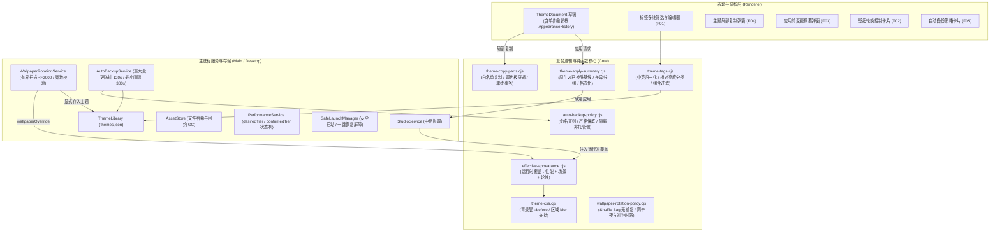

# Anti Face Round 7 (v0.6.0) 架构设计与共用隔离规范

日期：2026-10-12
版本：v0.6.0
架构核心原则：草稿、保存文档、有效外观三层分离；单步撤销事务保护；安全屏障与优先级协调；无外部云依赖、无不受限磁盘遍历。

---

## 1. 核心架构三层模型

---

## 2. 五项新增功能详细设计与隔离规范

### F01: 主题标签与多维分类 (Theme Tags & Multi-filter)
- **数据结构与约束**：
  - 标签属于主题元数据，存储于 `themes.json` 中每个主题实体的 `tags` 数组（字符串数组）。
  - 单个主题最多 10 个标签，单标签最大 20 字符，总字符不超过 100。
  - 标签经过 Unicode NFC 归一化、中英混合支持、移除不可见控制符、大小写折叠。
- **深浅色自动分类**：
  - 不仅依赖 themeId，基于背景色 Hex/RGB 计算相对亮度（W3C WCAG 相对亮度算法：\(L = 0.2126R + 0.7152G + 0.0722B\)）。\(L < 0.2\) 判定为深色（dark），反之为浅色（light）。
- **隔离规则**：
  - 修改标签仅改变主题库持久化元数据，**绝不改变宿主运行期 CSS，不触发注入，不产生外观撤销历史**。

### F02: 本地壁纸文件夹轮换 (Local Wallpaper Folder Rotation)
- **有界扫描与安全边界**：
  - 严格限制扫描深度（最多 3 层）与最大候选数量（上限 2000 张），防止目录爆栈。
  - 路径严格校验：绝不允许将壁纸文件夹选择在 `userData` 内部（防止递归监控与备份膨胀）。
  - 候选文件读取头部魔数（PNG: `89 50 4E 47`, JPEG: `FF D8 FF`, WEBP: `RIFF....WEBP`），杜绝改后缀的虚假/损坏文件。
- **Shuffle Bag 算法**：
  - 乱序模式维护一个“无放回摇号袋”，在袋子抽空后重新洗牌，并在重新装填时强制比较上一轮最后一张图片与新袋子第一张图片，若相同则后移，实现**跨周期无相邻重复**。
- **时钟唤醒与防堆叠**：
  - 休眠唤醒或长时间滞后使用 `computeNextRotationTime` 计算合法的下一触发时间点，绝不产生定时器事件风暴。
- **租约流转与不污染保存主题**：
  - 轮换以 `rotation:${targetId}` 租约注册到 `AssetStore`。新壁纸成功加载后先加新租约，再释放旧租约，防止 GC 竞态误删。
  - 轮换只修改 `context.wallpaperOverride`，`provenance['wallpaper.assetId'] = 'rotation'`，**绝不写回用户的保存主题 JSON，不生成持续膨胀的 Revision 历史**。
  - 仅当用户在 UI 点击“存入主题”时，才原子化转换为永久 `appearance` 租约并存入正式主题版本。

### F03: 应用前变化摘要与结果反馈 (Pre-apply Summary & Honest Status)
- **原生基线 vs 已换肤基线**：
  - 首次向原生窗口换肤时，基线明确标记为 `baselineKind: 'native'`，旧值诚实展示为“原生默认”，绝不伪造虚假的十六进制色值或 0px 参数。
  - 已换肤窗口对比目标窗口的 `lastVerified` 文档，生成字段级对比。
- **结构化分组与分类**：
  - 分组呈现：调色板配色 (`colors`)、排版文字 (`typography`)、壁纸与构图 (`wallpaper`)、区域样式 (`regions`)。
  - 自动叠加层提示：明确列出运行期有效外观叠加层（性能策略模糊度削减、场景感知对比度优化、活动壁纸轮换覆盖）。
- **诚实结果反馈**：
  - 注入后根据样式验证状态反馈真实结果；若样式已生效但版本历史写盘失败，明确报告 `revisionSaved: false` 与对应重试入口，拒绝盲目假报全成功。

### F04: 主题局部复制 (Theme Partial Copy)
- **白名单部件分组**：
  - 允许复制组：`colors`（配色调色板）、`typography`（字体字号行距）、`wallpaper`（壁纸及构图参数）、`regions.sidebar`、`regions.chat`、`regions.composer`、`regions.card`。
  - 严禁复制：`id`、`name`、`schemaVersion`，绝不允许目标主题身份被覆盖。
- **可见调色板穿透解析**：
  - 默认开启 `copyVisiblePalette: true`。若源主题继承自不同的 `baseThemeId` 且自身的 `colors` 对象为空或部分缺省，局部复制会先经 `resolveDocument` 解析出源主题在宿主呈现的真实视觉颜色，再填充给目标，杜绝跨基底主题复制导致颜色丢失或回退默认的问题。
- **单步撤销事务**：
  - 局部复制在前端作为一次原子操作通过 `AppearanceHistory.push()` 存入草稿，用户点击一次“撤销”即可完全回退整批局部复制改动。

### F05: 自动备份与严格保留策略 (Auto Backup & Safe Retention)
- **触发与防抖机制**：
  - 支持 `afterMajorChange`（重大修改后防抖 2 分钟，最小触发间隔 5 分钟）与 `daily`（每日一次）调度模式。
  - 数据指纹（SHA-256）去重：备份前计算 `theme-library.json`、`appearance.json`、`preferences.json` 的复合哈希，若内容未改变则诚实跳过，不产生垃圾文件。
- **文件隔离与保底安全**：
  - 自动备份生成的文件严格符合文件名正则：`/^anti-face-auto_\d{4}-\d{2}-\d{2}T\d{2}-\d{2}-\d{2}_[a-f0-9]{8}\.antiface-backup$/`。
  - 保留清理算法（`selectBackupsToPrune`）：
    1. **只识别匹配上述正则的文件**，非自动备份（如用户手工导出的 `anti-face-backup-*.zip` 或其他用户文件）一律绝对排除，零风险。
    2. **始终保底至少 1 份最新的有效备份**：即使最新备份已超过设定的 `retainDays`，也绝对不予删除。
- **安全启动与迁移屏障协同**：
  - 当系统处于安全模式（SafeLaunch）或正在执行数据恢复/迁移（`migrationActive = true`）时，自动备份立即挂起，防止读入半完成状态导致数据包损坏。

---

## 3. P2 级性能自适应修复 (Baseline Grok v0.5.2 Fix)

- 修复了此前 Round 6 遗留的性能策略状态同步缺陷：
  - 彻底解耦 `desiredTier`（期望档位）与 `confirmedTier`（宿主已确认生效档位）。
  - 在宿主注入临时失败或超时挂起时，不再过早更新 `confirmedTier`；
  - 引入有界重试队列（最多 3 次有限重试，带退避机制）；重试期间若触发一键恢复或安全模式，立即清除在途队列。
  - 彻底解决了“第一次 apply 失败后 tier 已更新，下一次 changed=false 不再重试，界面显示省电但宿主未生效”的缺陷。
